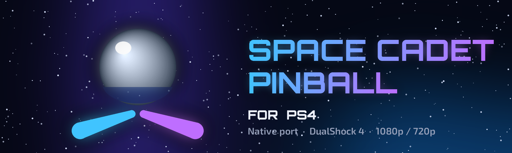

<p align="center">
  
</p>

<p align="center">
  <a href="https://github.com/iHaiDeeZ/SpaceCadetPinball-PS4/releases/latest"></a>
  
  
  <a href="LICENSE"></a>
</p>

<h3 align="center">The pinball table from Windows XP, on your PS4.</h3>

<p align="center">
  <a href="https://github.com/iHaiDeeZ/SpaceCadetPinball-PS4/releases/latest"><b>⬇ Get the latest release</b></a> ·
  <a href="#getting-started">Getting started</a> ·
  <a href="#controls">Controls</a> ·
  <a href="#the-pause-menu">Pause menu</a> ·
  <a href="#faq">FAQ</a> ·
  <a href="#thanks">Credits</a>
</p>

---

## Overview

Space Cadet Pinball for PS4 is a native port of
[k4zmu2a's decompilation](https://github.com/k4zmu2a/SpaceCadetPinball) of *3D Pinball for Windows –
Space Cadet*, the table that came with Windows. It runs as a normal app on a jailbroken PS4, plays with
a DualShock 4, and replaces the PC's mouse menus with a console-style pause menu.

It is the game's own code, compiled for the PS4's CPU: no emulator. The picture is drawn at 1080p (or
720p, which the PS4 scales up), and the table's sounds and MIDI music play through the PS4's audio.

You bring the game's files from your own copy of Windows. Nothing of Microsoft's is in the package.

## Highlights

**Made for a controller**
- Flippers on both shoulder pairs: **L1 or L2** and **R1 or R2**.
- **Cross** is the plunger: hold to pull it back, release to shoot.
- Nudge the table with the d-pad. Every button can be changed in **Options → Button Assignment**.

**A console-style pause menu**
- **Options** or the **touch pad** pauses the game and opens it: resume, new game, how to play,
  options, high scores, about.
- A **How to Play** page with the rules and every button, shown the first time the game starts.
- Large text, drawn PlayStation button prompts, and a hint for the selected row.

**Picture and sound**
- **1080p or 720p** (Options → Resolution). 720p draws 2.25 times fewer pixels.
- **30 or 60 fps**, physics at 60, 120 or 240 steps a second, an optional FPS counter.
- Smooth or sharp scaling, and with or without the table's own aspect ratio.
- The table's music (`PINBALL.MID`) plays on a built-in synthesizer, with free instruments in the
  package.

## Getting started

**You need:** a jailbroken PS4 with **GoldHEN**, an FTP client, and the game's files from Windows
XP's 3D Pinball (or *Full Tilt! Pinball*'s Space Cadet table).

1. Download `SpaceCadetPinball-iHaiDeeZ-vX.YY.pkg` from the
   [latest release](https://github.com/iHaiDeeZ/SpaceCadetPinball-PS4/releases/latest) and install it
   with GoldHEN's **Package Installer** (copy it to `/data/pkg` first).
2. Copy the game's files into **`/data/SpaceCadetPinball/`** on the PS4 by FTP, all in that one
   folder:
   - Windows XP: everything in `C:\Program Files\Windows NT\Pinball\`: `PINBALL.DAT`, `FONT.DAT`,
     `PINBALL.MID` and the `SOUND*.WAV` files.
   - Full Tilt!: `CADET.DAT` and its sound files.
3. Start **Space Cadet Pinball** from the home screen.

> **Tip:** if the files are missing, the game says so on screen and lists where it looked. Upper- or
> lower-case file names both work.

**Updating:** install the newer package over the old one. Your settings and high scores stay in
`/data/SpaceCadetPinball/`.

## Controls

| Button | Action |
|---|---|
| **L1** or **L2** | Left flipper |
| **R1** or **R2** | Right flipper |
| **Cross** (hold, release) | Plunger: launch the ball |
| **D-pad ← / →** | Nudge the table left / right |
| **D-pad ↑** | Nudge the table up |
| **Triangle** | New game |
| **Options** or **touch pad** | Pause menu |

In the menus: **d-pad** or left stick to move, **Cross** to pick, **← / →** to change a value,
**Circle** to go back.

**How a game goes:** the ball starts on the plunger in the lane on the right. Launch it, keep it alive
with the flippers, and hit targets to light missions (shown in the panel beside the table). You have
three balls; nudging too often tilts the table and the flippers stop until the ball drains.

## The pause menu

| Row | What it does |
|---|---|
| Resume | Back to the table |
| New Game | Start over |
| Launch Ball | Put the next ball on the plunger |
| How to Play | The rules and every button |
| Options | The settings below |
| High Scores | The best five games |
| About | Version and credits |
| Quit Game | Close the app (asks first) |

**Options**

| Section | Rows |
|---|---|
| Audio | Sound Effects, Sound Volume, Music, Music Volume |
| Display | Resolution (1080p / 720p), Frame Rate (30 / 60), Smooth Scaling, Sharp Pixels, Keep Aspect Ratio, Menu Text Size, Show FPS (and Table Detail with Full Tilt's data) |
| Gameplay | Players (1-4), Physics Rate (60 / 120 / 240), Button Assignment |

## Your files

Everything lives in **`/data/SpaceCadetPinball/`**:

| File | What it is |
|---|---|
| `PINBALL.DAT`, `*.WAV`, ... | The game's files, which you copy there |
| `imgui_pb.ini` | Settings, button assignment and high scores |
| `ps4.cfg` | The PS4 settings: resolution, frame rate, FPS counter |
| `log.txt`, `log-prev.txt` | What this run (and the one before) printed: useful in bug reports |

## FAQ

**The game says the .dat file is missing.** The files aren't in `/data/SpaceCadetPinball/`, or they
are in a subfolder there. Put them directly in that folder.

**There is no music.** Turn it on in **Options → Music**: the setting is off on the PC version, and a
settings file from an older version keeps that. Full Tilt's table has no `PINBALL.MID`.

**It isn't smooth.** Try **Options → Resolution → 720p** and turn **Smooth Scaling** off. **Show FPS**
puts a counter in the corner.

**How do I type my name for a high score?** You can't yet: there's no on-screen keyboard, so the
default name is kept. Press Cross on **OK**.

**Can I use the 3D Pinball files from a newer Windows?** Space Cadet shipped up to Windows XP. Any
copy of those files works, as does Full Tilt! Pinball's.

## Good to know

- Drawn by the PS4's CPU (SDL's software renderer), not its GPU: the table is 2D, and this keeps the
  port small and simple.
- The PC version's menu bar is hidden on the PS4; everything it had that matters on a console is in
  the pause menu.
- One controller plays; up to four players take turns.

## Building

The port is the `ps4` branch of the decompilation with `Platform/PS4/` (video, pad, menus), small
`#ifdef __ORBIS__` changes in the game's files, and `scripts/ps4/build-pinball.sh`. It builds in WSL
with clang 21 on the OpenOrbis toolchain and **ps4-kit**, our shared PS4 runtime, which is not
published yet. Design notes: [docs/ps4/DESIGN.md](docs/ps4/DESIGN.md).

```bash
scripts/ps4/build-pinball.sh deps                       # SDL2, SDL2_mixer, the music instruments
PINBALL_NO_DATA=1 PINBALL_VERSION=01.00 scripts/ps4/build-pinball.sh
```

## Thanks

- **[k4zmu2a and contributors](https://github.com/k4zmu2a/SpaceCadetPinball)**: the decompilation this
  port is built on. Their README is in [docs/UPSTREAM-README.md](docs/UPSTREAM-README.md).
- **Cinematronics and Maxis**: the original table (1995).
- **[SDL](https://www.libsdl.org) and [SDL_mixer](https://github.com/libsdl-org/SDL_mixer)**, **[Dear ImGui](https://github.com/ocornut/imgui)**, the **[OpenOrbis](https://github.com/OpenOrbis) toolchain** and **GoldHEN**.
- **freepats**: the music's instruments (GPL). **Exo 2** and **Orbitron**: the menus' fonts (SIL Open Font License).

## License and disclaimer

The code is MIT, as the decompilation it builds on (see [LICENSE](LICENSE)); the fonts and freepats
keep their own licenses (in the package next to them).

This project has no connection with Microsoft, Cinematronics, Maxis or Sony. *3D Pinball*, *Space
Cadet*, *Windows* and *PlayStation* are trademarks of their owners. The package contains none of the
game's files: use files from software you own.
